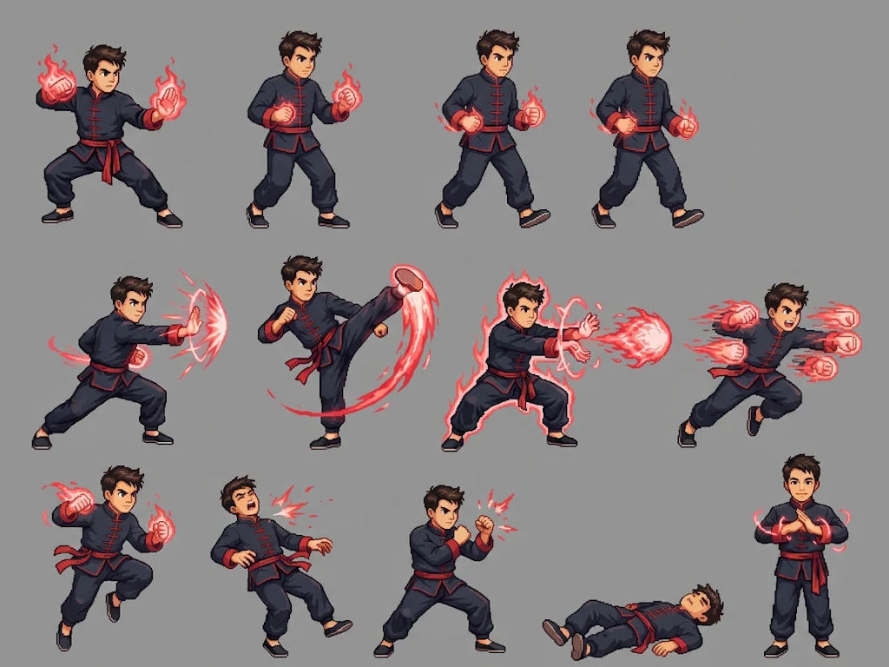
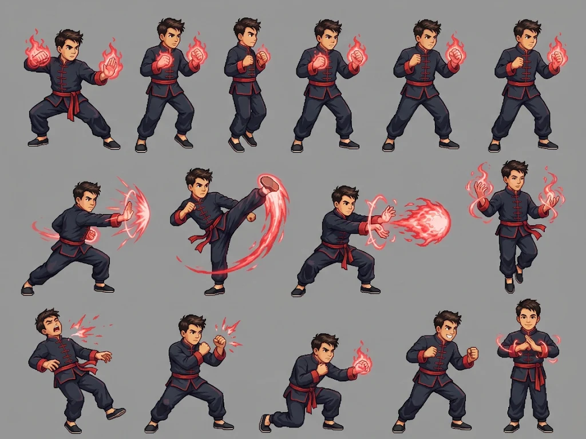

# Alejandro «Ajex» — Referencia visual

## Principal: hoja de sprites (Gemini, sprites v1)

> Estado: **principal** · 23/11/2026 · Fuente: Gemini (generada por nosotros, uso libre en el proyecto).
> Ya está adaptada a la ficha prototipo (super cuerpo a cuerpo, sin agacharse). Sirve como referencia para PixelLab; no se usa directo en el juego (no es pixel art real a tamaño de sprite y el fondo es gris).

### Diseño que queda fijo
- Cabello castaño oscuro, complexión delgada y atlética.
- **Traje de kung fu negro** con ribetes rojos y botones chinos, **faja roja**, pantalón negro holgado, zapatos negros de kung fu.
- Poder: **fuego rojo/carmesí** en puños y pies. **Sin proyectiles.**
- Mira a la derecha (en Unity se voltea con `flipX`).

### Qué hay en la imagen (por fila)
| Fila | Poses | Uso en el juego |
| --- | --- | --- |
| 1 | Guardia + 3 pasos | **Idle** y **caminar** |
| 2 | Palma con anillo de fuego, patada alta con estela, postura con aura roja lanzando fuego, ráfaga de puños en llamas | **L**, **F**, **E** (ver problemas), **super** |
| 3 | Salto, recibe golpe, bloqueo, KO en el suelo, saludo marcial | **Saltar**, **recibir golpe**, **bloquear**, **KO**, **victoria** |

### Problemas a corregir en PixelLab
> **Decisión (23/11/2026):** no se regenera la hoja en Gemini (podría romper las poses que salieron bien). Estos fallos se corrigen al generar los sprites en PixelLab, describiendo cada pose por texto. Solo se regeneraría si se quiere mostrar en clase como arte conceptual sin errores.

- **Guardia del Dragón (E):** la pose 3 de la fila 2 dispara una **bola de fuego** (proyectil), y Ajex ya no tiene proyectiles. Usar solo la postura con el aura roja y cambiar la bola por una palma corta con estallido pegado a la mano (contraataque).
- Falta la **postura quieta** de la guardia (antes de que lo golpeen): aura roja, palma al frente, sin atacar.
- Fuego en las manos en idle y caminar: dejarlo en flama pequeña, fuego fuerte solo al atacar.
- El estilo es más suave que el pixel art de 16 bits; PixelLab lo resuelve al regenerarlo a 128×128.

## Secundaria: diseño original (Gemini v1)

Primera referencia del personaje. Se queda solo como referencia de diseño (ropa y colores); sus poses de bola de fuego, levitación y agachado **ya no aplican** a la ficha.

## Plan en PixelLab (cuenta Pro)
1. `create_character` vista lateral a partir de la guardia de la hoja principal (fila 1, poca flama).
2. Animaciones por texto (v3), con la guardia como primer y último frame: idle → caminar → L (palma) → F (patada) → Guardia del Dragón + contraataque → super (ráfaga de puños) → saltar → bloquear → recibir golpe → KO → victoria (saludo).
3. Efecto de fuego del super encima del sprite (no es un proyectil).
4. Exportar a `Assets/_Project/Art/Characters/Ajex/`.
