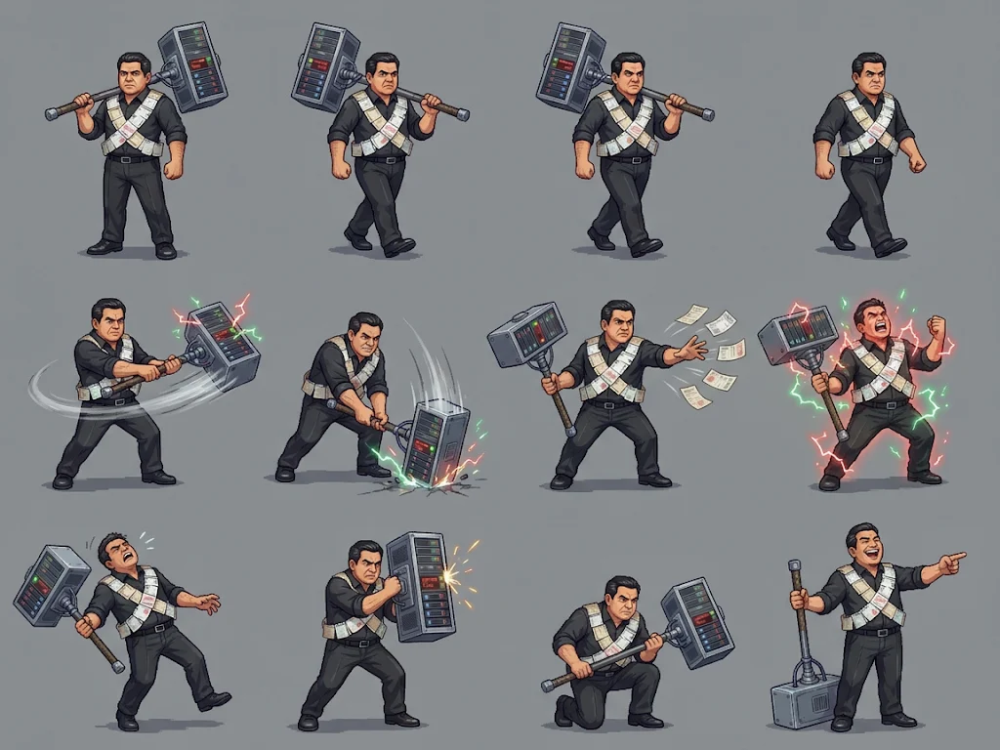

# «El Sinodal» (jefe) — Referencia visual (Gemini v1)

> Estado: **aprobada como idea base** · 23/11/2026 · Fuente: Gemini (generada por nosotros, uso libre en el proyecto).
> Sirve como referencia para crear al jefe en PixelLab (cuenta Pro). No se usa directo en el juego.
> Basado en un compañero: **ya dio su permiso** (23/11/2026).

## Diseño que queda fijo
- Cabello negro corto, robusto, expresión seria.
- **Camisa y pantalón negros**, zapatos negros, **dos bandas cruzadas** en el pecho hechas de hojas de examen.
- Arma: **martillo con cabeza de gabinete de PC/servidor** (LEDs rojos y verdes), mango metálico.
- Efectos: **descargas eléctricas verdes y rojas**, hojas de examen volando.
- Cambia respecto al prompt original (abrigo azul marino, sello "REPROBADO"): **se queda el diseño de la imagen**. El "REPROBADO" puede aparecer como texto/efecto en el super.

## Qué hay en la imagen (por fila)
| Fila | Poses | Uso en el juego |
| --- | --- | --- |
| 1 | Martillo al hombro + 3 pasos | **Idle** y **caminar** |
| 2 | Barrido horizontal con chispas, azote al piso, lanzar hojas, pose de rabia con electricidad | **F** (barrido), **Sello de Reprobado** (azote), **Lluvia de Exámenes** (hojas), **super** / fase 2 (rabia) |
| 3 | Recibe golpe, bloqueo con el martillo, agachado cargando, victoria señalando y riéndose | **Recibir golpe**, **bloquear**, **victoria**; el agachado puede ser el inicio del azote |

## Problemas a corregir en PixelLab
- Falta un golpe rápido sin martillo para **L** (Codazo de Autoridad).
- En el azote al piso falta la **onda eléctrica** en el suelo: hacerla como efecto aparte (la debe saltar el jugador).
- Mantener el martillo del mismo tamaño en todos los frames y siempre unido a las manos.
- Las hojas lanzadas deben ser un **sprite aparte** (proyectil), no parte del personaje.

## Lo que falta (no está en la imagen)
- **L:** codazo.
- **Examen Extraordinario** (super): lluvia de hojas en pantalla completa + martillazo final con "REPROBADO".
- Saltar, KO. (La intro "Su calificación es…" pasó a la visión final.)
- Efectos aparte: hoja de examen (proyectil), onda eléctrica en el suelo, chispas.

## Plan en PixelLab (cuenta Pro)
1. `create_character` vista lateral, 160×128, a partir de esta referencia (martillo al hombro, fila 1).
2. Animaciones por texto (v3), con la guardia como primer y último frame: idle → caminar → L (codazo) → F (barrido) → Lluvia de Exámenes → Sello de Reprobado → super → bloquear → recibir golpe (frames 1–3 + último) → KO → victoria.
3. Hoja, onda eléctrica y chispas como efectos aparte.
4. Exportar a `Assets/_Project/Art/Characters/Boss/`.
