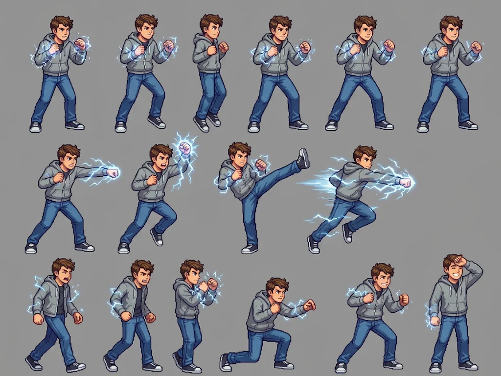

# Elias — Referencia visual (Gemini v1)

> Estado: **aprobada como idea base** · 23/11/2026 · Fuente: Gemini (generada por nosotros, uso libre en el proyecto).
> Sirve como referencia para crear a Elias en PixelLab (cuenta Pro). No se usa directo en el juego: no es pixel art real a tamaño de sprite y el fondo es gris.

## Diseño que queda fijo
- Cabello **castaño** alborotado, piel clara, complexión delgada.
- **Sudadera gris** con capucha y cierre, playera oscura, **jeans azules**, tenis negros con suela blanca.
- Poder: **destellos eléctricos azul claro** (rayos). Se usan como efecto del teleport y de los golpes con súper fuerza.
- Mira a la derecha (en Unity se voltea con `flipX`).
- Reemplaza al prototipo "Elias prototipo" de PixelLab (sudadera azul marino), que se descarta.

## Qué hay en la imagen (por fila)
| Fila | Poses | Uso en el juego |
| --- | --- | --- |
| 1 | 6 frames de guardia con chispas | **Idle** |
| 2 | Puñetazo eléctrico, gancho hacia arriba cargado, patada alta, embestida con puño y estela de rayos | **L** (puñetazo), **super** (la embestida sirve de golpe inicial de Sobredosis de Temp V). El gancho y la patada **se descartan** (23/11/2026) |
| 3 | Caminar ×3, embestida agachado, sonrisa, rascándose la cabeza apenado | **Caminar**, **victoria** (la de apenado le queda a su personalidad torpe) |

## Problemas a corregir en PixelLab
- Las chispas aparecen en **todos** los frames, hasta en idle y caminar. Recomendado: idle y caminar **sin rayos** (o solo 1–2 chispas sutiles); rayos fuertes solo en ataques, teleport y super. Así se nota cuándo hace algo.
- Mantener el mismo color de rayo (azul claro) en todos los frames.
- Falta el **Empujón a dos manos** (su F): ninguna pose lo muestra.

## Lo que falta (no está en la imagen)
- **Empujón a dos manos** (F): las dos palmas al frente con estallido de rayos.
- **Blink Trasero** (especial): desaparecer en un destello eléctrico y reaparecer (3 + 3 frames); efecto como sprite aparte, reutilizable en el super.
- **Sobredosis de Temp V** (super): golpe inicial + teleports alrededor del rival pegándole desde varios lados (izquierda, derecha, arriba) + remate.
- Saltar, bloquear, recibir golpe, KO.

## Plan en PixelLab (cuenta Pro)
1. `create_character` vista lateral, 128×128, a partir de esta referencia (guardia de la fila 1, sin rayos).
2. Animaciones por texto (v3), con la guardia como primer y último frame: idle → caminar → L → F (empujón) → Blink (desaparecer/reaparecer) → super → bloquear → recibir golpe (frames 1–3 + último) → KO → victoria.
3. Destello/rayo del teleport como efecto aparte.
4. Exportar a `Assets/_Project/Art/Characters/Elias/`.
