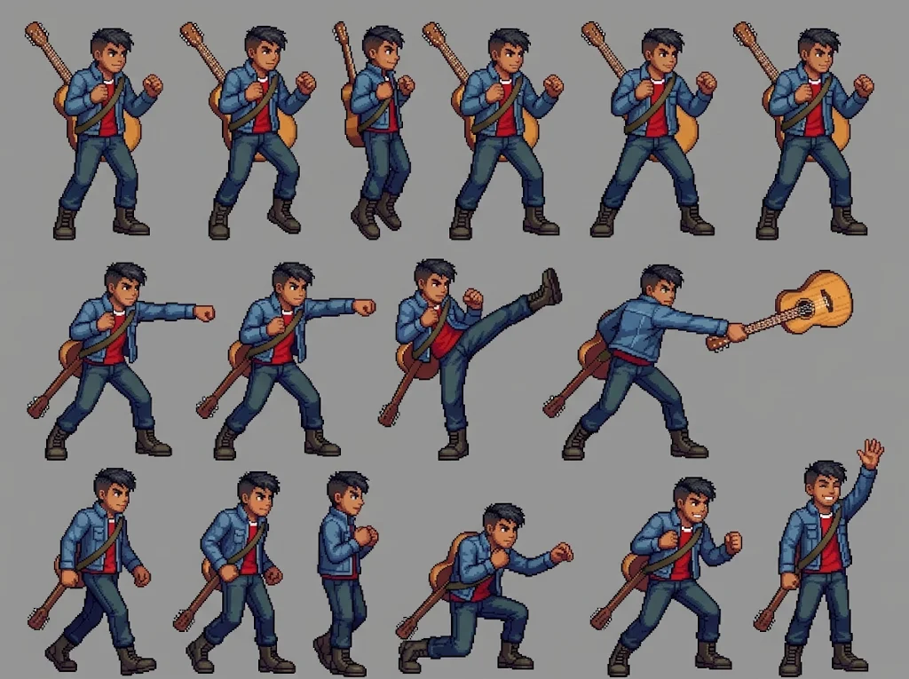

# Leo — Referencia visual (Gemini v1)

> Estado: **aprobada como idea base** · 23/11/2026 · Fuente: Gemini (generada por nosotros, uso libre en el proyecto).
> Sirve como referencia para crear a Leo en PixelLab (cuenta Pro). No se usa directo en el juego: no es pixel art real a tamaño de sprite y el fondo es gris.

## Diseño que queda fijo
- Cabello negro corto y alborotado, piel morena clara, complexión delgada.
- Chamarra de mezclilla azul con las mangas un poco remangadas, **playera roja**, jeans azul oscuro, botas cafés.
- Guitarra acústica de madera clara colgada a la espalda con una correa café cruzada al pecho.
- Mira a la derecha (en Unity se voltea con `flipX`).

## Qué hay en la imagen (por fila)
| Fila | Poses | Uso en el juego |
| --- | --- | --- |
| 1 | 6 frames de guardia / respiración | **Idle** (usar 1 como pose base en PixelLab) |
| 2 | Puñetazo ×2, patada alta, guitarrazo | **L** (puñetazo), **F** (guitarrazo). La patada **se descarta** (23/11/2026) |
| 3 | Caminar ×3, embestida agachado, burla, saludo de victoria | **Caminar**, **victoria**; la embestida puede servir de inicio del super |

## Problemas a corregir en PixelLab
- La guitarra cambia de posición entre frames (a veces cuelga atrás, a veces se ve en la mano). Fijarla **a la espalda** salvo en el guitarrazo y los especiales.
- En el guitarrazo la guitarra parece flotar separada de la mano: pedir que la sujete del mástil con las dos manos.
- La playera es roja (el prompt decía oscura): se queda roja, ayuda a la silueta.

## Lo que falta (no está en la imagen)
- **Onda Acústica** (rasgueo + sprite aparte de la nota/onda, 2 frames en bucle).
- **Concierto Final** (super: solo de guitarra + luz de escenario).
- Saltar, bloquear, recibir golpe, KO.

## Plan en PixelLab (cuenta Pro)
1. `create_character` vista lateral, 128×128, a partir de esta referencia (frame 1 de la fila 1).
2. Animaciones por texto (v3), con la guardia como primer y último frame: idle → caminar → L → F (guitarrazo) → Onda Acústica → super → bloquear → recibir golpe (frames 1–3 + último) → KO → victoria.
3. Proyectil de la onda como objeto aparte.
4. Exportar a `Assets/_Project/Art/Characters/Leo/`.
