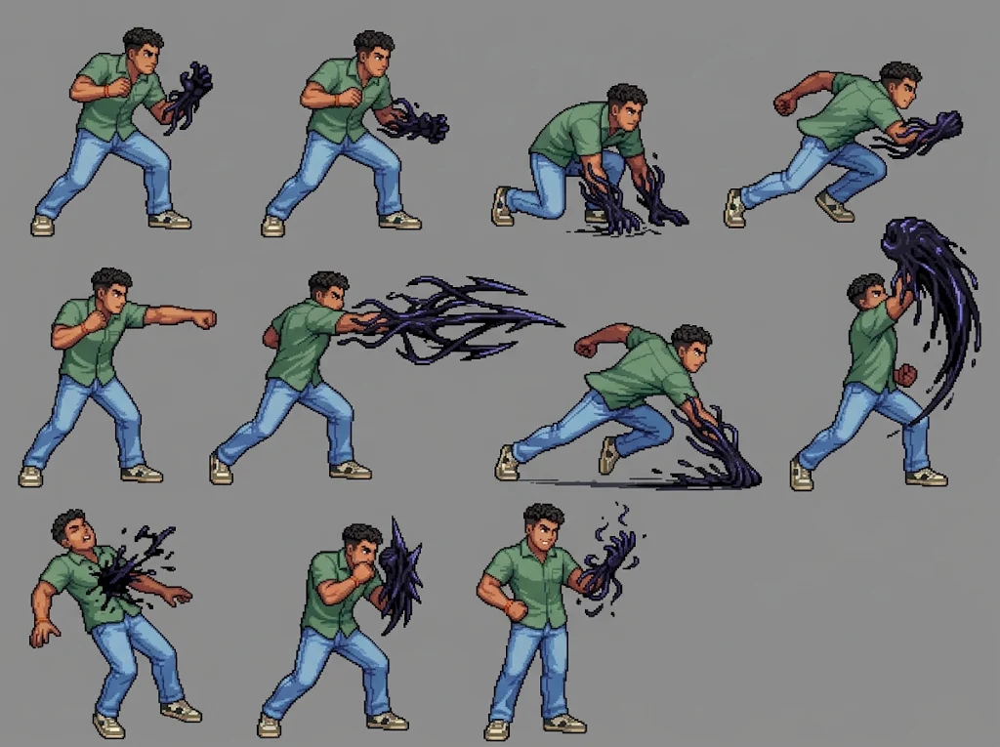

# Oscar — Referencia visual (Gemini v1)

> Estado: **aprobada como idea base** · 23/11/2026 · Fuente: Gemini (generada por nosotros, uso libre en el proyecto).
> Sirve como referencia para crear a Oscar en PixelLab (cuenta Pro). No se usa directo en el juego: no es pixel art real a tamaño de sprite y el fondo es gris.

## Diseño que queda fijo
- Cabello negro corto y rizado, piel morena, complexión atlética y delgada.
- **Camisa verde de botones** manga corta, **jeans azul claro**, tenis claros, pulsera naranja en la muñeca derecha.
- Biomasa: materia **negra con brillos morados**, viscosa, con gotas que salpican.
- Mira a la derecha (en Unity se voltea con `flipX`).

## Qué hay en la imagen (por fila)
| Fila | Poses | Uso en el juego |
| --- | --- | --- |
| 1 | Guardia con garra ×2, agachado con garras en el piso, embestida con garra | **Idle** (guardia, con brazos normales). El agachado y la embestida **se descartan** (24/11/2026) |
| 2 | Puñetazo normal, látigo de púas extendido, zarpazo bajo al suelo, golpe hacia arriba con masa negra | **F** (látigo de púas). El puñetazo normal, el zarpazo bajo y el golpe hacia arriba **se descartan** (24/11/2026); L es el Zarpazo con garra (no está en la imagen) |
| 3 | Recibe golpe (salpicadura en el pecho), bloqueo con escudo de biomasa, pose final con la garra deshaciéndose | **Recibir golpe**, **bloquear**, **victoria** |

## Problemas a corregir en PixelLab
- En la guardia ya tiene la garra puesta. **Decidido (23/11/2026): la biomasa sale solo al atacar** (y en el bloqueo). En idle, caminar y saltar tiene **brazos normales**.
- El látigo de púas se ramifica mucho; para el **Tentáculo Atractor** se necesita **un solo tentáculo largo y recto** (hitbox 3.0×0.4) que termine en garra para jalar.
- **Decidido (24/11/2026):** L es el **Zarpazo** con garra (zarpazo horizontal a la altura del pecho).
- Mantener la pulsera naranja y la camisa de botones en todos los frames.

## Lo que falta (no está en la imagen)
- **Tentáculo Atractor** (especial): tentáculo largo y recto que jala al rival.
- **Zarpazo** (L): garra horizontal a la altura del pecho.
- **Frenesí Simbiótico** (super): forma monstruosa; los tentáculos atrapan al rival, lo levantan y lo azotan contra el piso + azotón final.
- Caminar, saltar, KO.
- Efecto de salpicadura negra como sprite aparte (sirve para golpes y para el super).

## Plan en PixelLab (cuenta Pro)
1. `create_character` vista lateral, 128×128, a partir de esta referencia (guardia de la fila 1, pero con brazos normales).
2. Animaciones por texto (v3), con la guardia como primer y último frame: idle → caminar → L (zarpazo) → F (látigo) → Tentáculo Atractor → super → bloquear → recibir golpe (frames 1–3 + último) → KO → victoria.
3. Salpicadura de biomasa como objeto/efecto aparte.
4. Exportar a `Assets/_Project/Art/Characters/Oscar/`.
