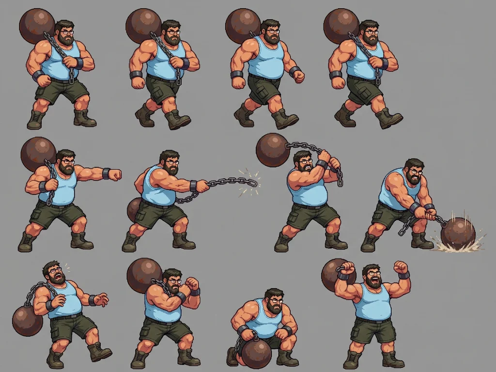

# Panchito — Referencia visual (Gemini v1)

> Estado: **aprobada como idea base** · 23/11/2026 · Fuente: Gemini (generada por nosotros, uso libre en el proyecto).
> Sirve como referencia para crear a Panchito en PixelLab (cuenta Pro). No se usa directo en el juego: no es pixel art real a tamaño de sprite y el fondo es gris.

## Diseño que queda fijo
- Grandote, musculoso y panzón; cabello negro corto, **barba y lentes**, piel morena clara.
- **Tank top azul claro**, **shorts cargo verde olivo**, botas cafés, muñequeras negras.
- Arma: **bola de demolición café oscuro con cadena**, cargada al hombro.
- Lienzo más grande que los demás: **160×128** (por la bola). Mira a la derecha (`flipX` en Unity).

## Qué hay en la imagen (por fila)
| Fila | Poses | Uso en el juego |
| --- | --- | --- |
| 1 | Guardia con la bola al hombro + 3 pasos | **Idle** y **caminar** |
| 2 | Puñetazo, lanza la cadena al frente, alza la bola sobre la cabeza, la azota contra el suelo | **L** (puñetazo), **F / Demoledor** (alzar + azotar). **Lanzar la cadena: no se usa** (descartada 24/11/2026) |
| 3 | Recibe golpe, bloqueo, agachado cargando la bola, victoria con brazos arriba | **Recibir golpe**, **bloquear**, **victoria**; el **agachado es el inicio del Super (Demolición)** |

## Problemas a corregir en PixelLab
- L: **Decidido (23/11/2026): puñetazo** (se entiende mejor que el panzazo). Usar el puñetazo de la fila 2.
- ~~Lanzamiento de cadena (fila 2, frame 2)~~: **no se usa**, no animarla en PixelLab.
- La bola cambia de tamaño entre frames: mantener **un solo tamaño**.
- La bola debe verse siempre conectada a la cadena y a la mano (que no flote).
- Mantener lentes, barba y muñequeras en todos los frames.

## Lo que falta (no está en la imagen)
- **Tornado** (especial): girar en su lugar con la bola dando vueltas alrededor (bucle).
- **Demolición** (super): carrera con la bola + giro de 3 golpes + azote al piso.
- Saltar, KO.
- Efecto de polvo/impacto al azotar la bola como sprite aparte (reutilizable).

## Plan en PixelLab (cuenta Pro)
1. `create_character` vista lateral, 160×128, a partir de esta referencia (guardia de la fila 1).
2. Animaciones por texto (v3), con la guardia como primer y último frame: idle (respiración pesada) → caminar → L → F (Demoledor) → Tornado → super → bloquear → recibir golpe (frames 1–3 + último) → KO → victoria.
3. Polvo de impacto como efecto aparte.
4. Exportar a `Assets/_Project/Art/Characters/Panchito/`.
