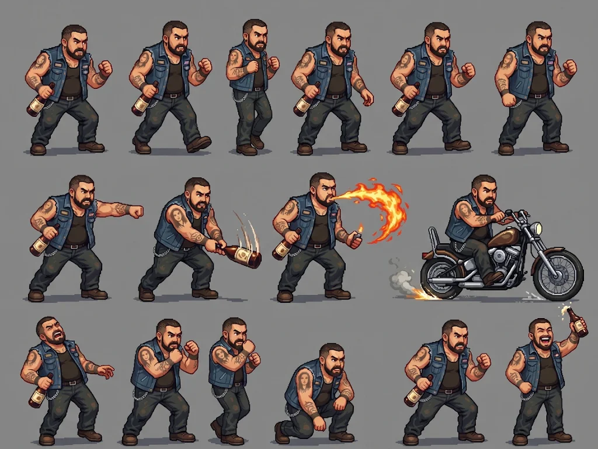

# Pedro — Referencia visual (Gemini v1)

> Estado: **aprobada como idea base** · 23/11/2026 · Fuente: Gemini (generada por nosotros, uso libre en el proyecto).
> Sirve como referencia para crear a Pedro en PixelLab (cuenta Pro). No se usa directo en el juego: no es pixel art real a tamaño de sprite y el fondo es gris.

## Diseño que queda fijo
- Robusto, barba y cabello negro corto, piel morena clara, **brazos tatuados**.
- **Chaleco de mezclilla sin mangas** con parches, playera negra, jeans oscuros, cadena de cartera, botas cafés, muñequeras.
- Botella café en la mano izquierda, encendedor para el fuego.
- **Moto** tipo chopper café con cromo (sprite aparte).
- Mira a la derecha (en Unity se voltea con `flipX`).

## Qué hay en la imagen (por fila)
| Fila | Poses | Uso en el juego |
| --- | --- | --- |
| 1 | 6 frames de guardia / pasos con la botella | **Idle** y **caminar** |
| 2 | Puñetazo, botellazo, escupir fuego con encendedor, montado en la moto | **L** (puñetazo), **F** (botellazo), **super** (fuego), **especial** (moto) |
| 3 | Recibe golpe, bloqueo ×2, agachado, burla, victoria brindando | **Recibir golpe**, **bloquear**, **victoria**; el agachado puede ser invocar la moto |

## Problemas a corregir en PixelLab
- La botella lleva una etiqueta de la marca **inventada «Chela Brava»** (decidido 24/11/2026). Nada de marcas ni logos reales (por ejemplo, Duff de Los Simpson no).
- Los tatuajes son muy detallados (uno parece la cara de una persona): en 128×128 no se van a leer; simplificarlos a manchas/diseños sencillos y que **no** sean la cara de alguien real.
- La moto es muy grande respecto a él: hacerla como **sprite aparte** del tamaño correcto (más o menos 2.5 u de largo).
- Mantener el chaleco con parches y la cadena en todos los frames.

## Lo que falta (no está en la imagen)
- **Embestida en Moto** completa: aparecer la moto, subirse, avanzar (bucle) y bajarse. En la imagen solo hay 1 frame montado.
- **Aliento de Dragón** (super): el trago antes de escupir y la llamarada como efecto aparte, más la pasada final en moto.
- Saltar, KO.
- Humo del escape como efecto aparte.

## Plan en PixelLab (cuenta Pro)
1. `create_character` vista lateral, 128×128, a partir de esta referencia (guardia de la fila 1).
2. Animaciones por texto (v3), con la guardia como primer y último frame: idle → caminar → L → F (botellazo) → montar moto → super (fuego) → bloquear → recibir golpe (frames 1–3 + último) → KO → victoria.
3. Moto (vista lateral, ruedas girando), llamarada y humo como objetos/efectos aparte.
4. Exportar a `Assets/_Project/Art/Characters/Pedro/`.
